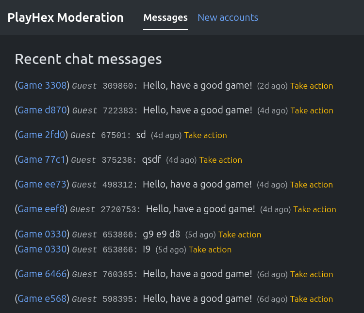
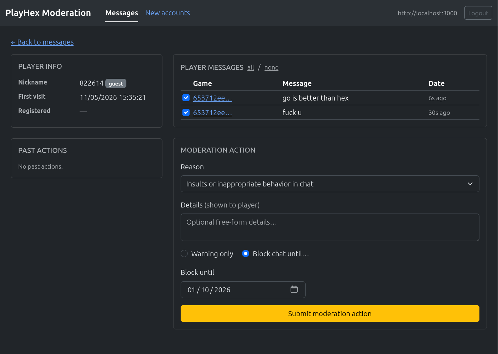
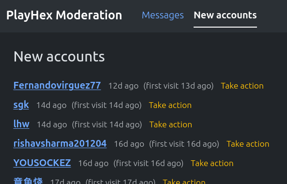

# PlayHex moderation

Moderation and admin tool for a PlayHex instance:

- **Moderation**: review last chat messages, new accounts, avatars, submitted videos (accept/refuse), puzzles (put back as draft)
  and auto moderated players (restricted by the server for posting forbidden words in chat, can be canceled if false positive),
  then take moderation action: warn player, block chat, block any content (avatar, puzzles, videos, tournaments...), ban IPs.
- **Admin**: tournaments featuring, feature usage stats (how many players use pronouns, avatars, linked accounts, studies...).

Pages are listed in the sidebar, see `SECTIONS` in `js/nav.js` to add one.

## Install

- Install dependencies: `npm install`
- Start the dev server: `npm run dev`, then go to `http://localhost:3001`
  - The server watches for file changes and restarts automatically
  - You can override the port with `PORT=8080 npm run dev`
- In your playhex `.env`, allow cors by adding moderation app url, and add a moderator password (admin password works too):

```
CORS_ALLOWED_ORIGINS=http://localhost:3001
MODERATOR_PASSWORD=myPassword
```

Now you can moderate your PlayHex instance, logins are:

- **API base Url**: your PlayHex instance (e.g `http://localhost:3001`)
- **Moderator API key**: your moderator password from .env (e.g `myPassword`)

Dates when messages, new accounts, avatars, videos, puzzles and auto moderated players have been marked as seen are stored on the server
(and no longer in the browser local storage), so they stay synchronized between all your devices.

On the "Tournaments featuring" page, editing or canceling a tournament goes through the admin API (same for the "Feature usage" page),
so you must be logged in with the **admin** password (`ADMIN_PASSWORD` in .env) and not the moderator one.

## Screenshots

All last chat messages from any are listed, so moderators can easily review all new messages at once:



If a message needs moderation action, moderator can display a warning to the player with the moderation reason,
and also block player chat for a period, or block player from posting any content (avatar, puzzles, videos, tournaments...). Past warning and chat blocks are also displayed to the moderator.



Last nicknames are also listed.


